<p><picture><source media="(max-width: 600px)" srcset="assets/readme/hero-mobile.svg"/>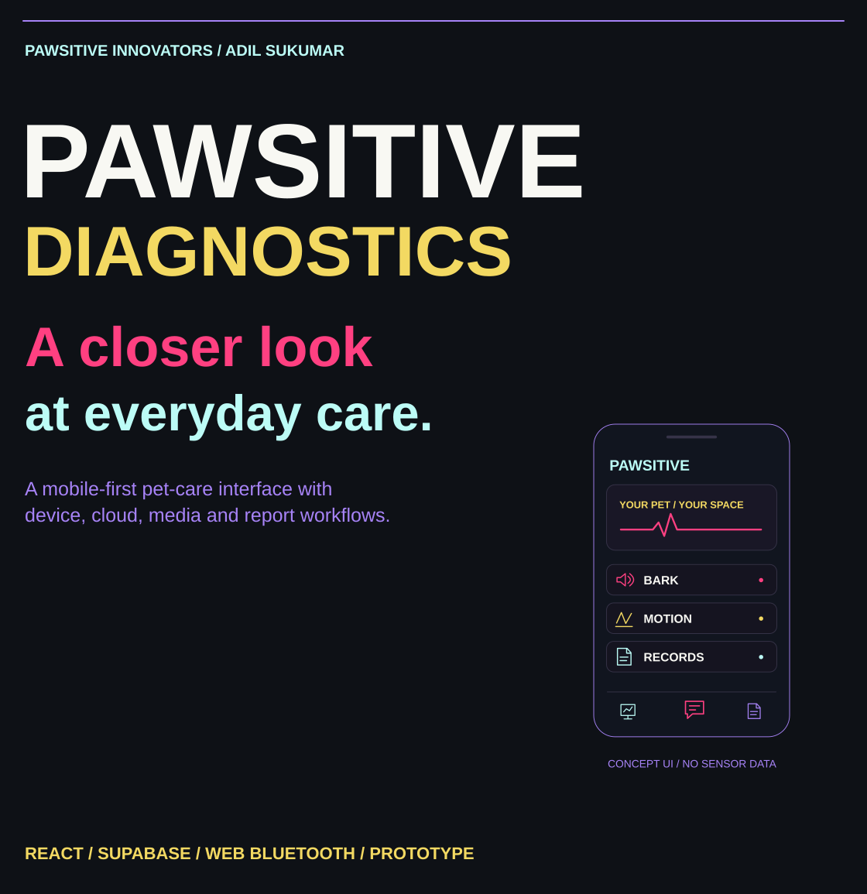</picture></p>

<p align="center"><a href="#the-care-workspace">Overview</a> · <a href="#the-sense-ai-suite">Sense suite</a> · <a href="#how-data-reaches-the-screen">Data paths</a> · <a href="#run-locally">Run locally</a> · <a href="#integration-status">Integrations</a> · <a href="#explore-the-source">Source</a></p>

<p><picture><source media="(max-width: 600px)" srcset="assets/readme/section-overview-mobile.svg"/>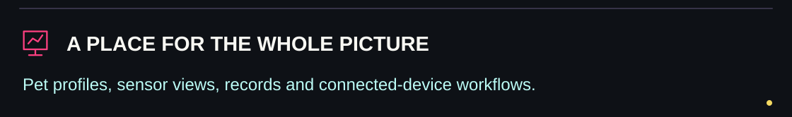</picture></p>

## The care workspace

I built this version of **Pawsitive Diagnostics** as a mobile-first pet-care workspace: pet profiles, Sense module views, collar connection, scan history, breed browsing, a conversational assistant and report exports. The project is developed under **Pawsitive Innovators**.

This repository is a **prototype application with integration paths**. Some paths consume device or cloud data; others use demo values, fixed outputs or fallback text. The interface and the presence of a model/helper name do not establish validated veterinary diagnosis, core-temperature measurement or disease detection.

[Original project logo](public/logo.png) · [Application routes](src/App.tsx) · [Hardware source](hardware/)


<p><picture><source media="(max-width: 600px)" srcset="assets/readme/section-suite-mobile.svg"/>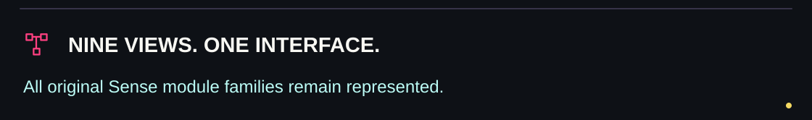</picture></p>

## The Sense AI suite

<p><picture><source media="(max-width: 600px)" srcset="assets/readme/suite-mobile.svg"/>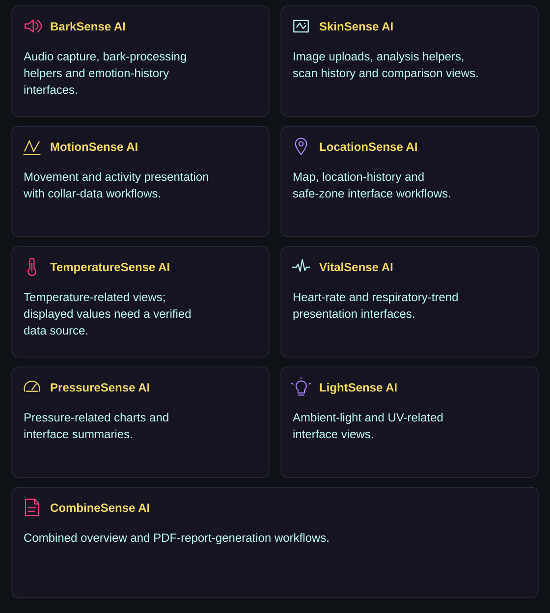</picture></p>

| Module | Included project area |
|---|---|
| BarkSense AI | Audio capture, feature/classifier helpers, emotion logs and history views |
| SkinSense AI | Image/text analysis helpers, scan history and before/after comparison workflows |
| MotionSense AI | Movement/activity presentation and collar-related interfaces |
| LocationSense AI | Location map, safe-zone and history interfaces |
| TemperatureSense AI | Temperature-related presentation and environmental context |
| VitalSense AI | Heart-rate and respiration-related presentation |
| PressureSense AI | Pressure-related charts and summaries |
| LightSense AI | Light/UV-related presentation |
| CombineSense AI | Combined overview, score presentation and PDF-report workflow |

These describe the implemented interface families, not independently verified sensor accuracy or diagnostic performance. Input availability, data freshness and the particular helper used matter. A collar surface reading is not established as core temperature by this repository.


<p><picture><source media="(max-width: 600px)" srcset="assets/readme/section-data-mobile.svg"/>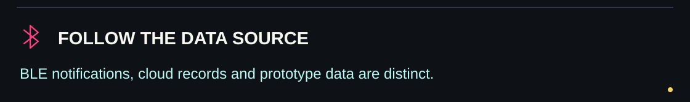</picture></p>

## How data reaches the screen

<p><picture><source media="(max-width: 600px)" srcset="assets/readme/paths-mobile.svg"/>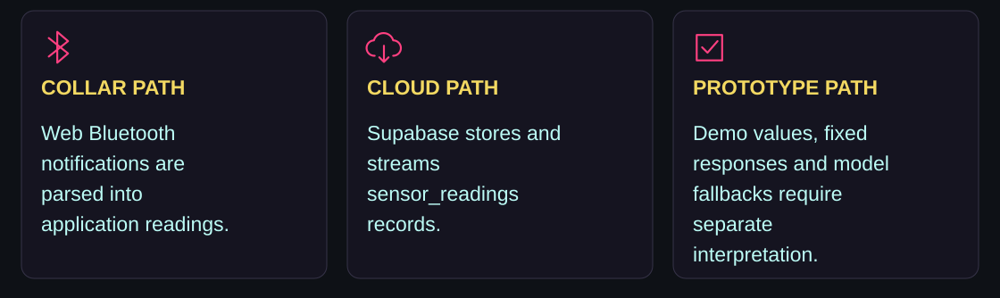</picture></p>

The dedicated [BLE hook](src/hooks/useBleCollar.ts) connects to a configured GATT service, subscribes to notifications and parses collar JSON fields such as bark spikes, gas values, scratch intensity and timestamps. It stores recent records locally and attempts to insert them into Supabase. Its service and characteristic UUIDs must match the firmware.

The [cloud-reading hook](src/hooks/useLiveSensorData.ts) fetches recent `sensor_readings` and subscribes to new inserts. Other hooks also use dog-specific browser storage. Several modules have their own data/helper paths; a connection indicator alone does not prove that every Sense module has a working physical sensor.

Browser permissions, device compatibility, database permissions and a suitable secure context are required for the relevant paths. Inspect [both hook implementations](src/hooks/sensorHooks.ts) when tracing a page: similarly named exports do not all implement the same BLE lifecycle.


<p><picture><source media="(max-width: 600px)" srcset="assets/readme/section-companion-mobile.svg"/>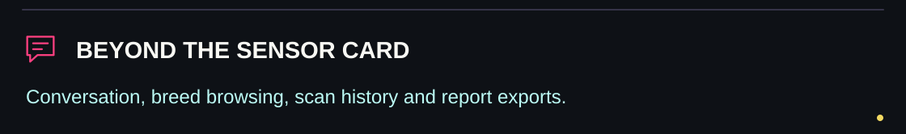</picture></p>

## Chat, breeds and reports

- **Pet chatbot:** the routed page calls Gemini when a key is configured and uses predefined replies when it is absent. A successful fallback display is not proof of a successful provider request.
- **Breed encyclopedia:** breed browsing, stored information and provider-backed detail-generation paths. Content and provider availability must be checked separately.
- **Scan history and comparison:** stored scan views and image-analysis/comparison helpers.
- **Reports:** combined summaries and browser-generated PDFs through jsPDF helpers.
- **Mobile interface:** Tailwind/Radix components, Lucide icons, Framer Motion, installation UI and Capacitor configuration.
- **Contact/SOS interface:** included in the app layout; configure contact details for the intended deployment.

Generated advice, heuristic labels, mock outputs and presentation scores should remain distinguishable from verified animal measurements. Some AI helpers return predefined assessment text after API errors; inspect the returned path before interpreting an output.


<p><picture><source media="(max-width: 600px)" srcset="assets/readme/section-setup-mobile.svg"/>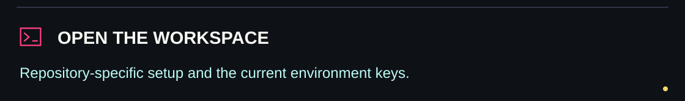</picture></p>

## Run locally

Use **Node.js 22 or newer** for the repository's Capacitor 8 toolchain; see the [Capacitor requirements](https://capacitorjs.com/docs/updating/8-0).

```bash
git clone https://github.com/adilsukumar/Pawsitive-Diagnostics-V1.git
cd Pawsitive-Diagnostics-V1
npm install
```

Create `.env` in the project root. The current generated Supabase client reads these names:

```dotenv
VITE_SUPABASE_URL=https://your-project.supabase.co
VITE_SUPABASE_PUBLISHABLE_KEY=your_client_api_key
VITE_GEMINI_API_KEY=your_optional_gemini_key
```

**Configuration detail:** `.env.example` currently lists `VITE_SUPABASE_ANON_KEY`, while [client.ts](src/integrations/supabase/client.ts) reads `VITE_SUPABASE_PUBLISHABLE_KEY`. Use the name the client actually reads. The example also declares `VITE_ML_API_URL`; its presence alone does not connect every page to the Python backend.

```bash
npm run dev
npm run build
npm run preview
npm run lint
npm test
```

Vite requests port **8080**; follow the URL printed in the terminal. The package also includes `build:dev` and `test:watch`. Match the Supabase schema, auth settings, storage and permissions to the application; SQL/migrations are included in `supabase/`.

`VITE_` values are bundled into browser JavaScript. Use client-scoped keys here; privileged server credentials do not belong in that namespace. This documentation update does not alter environment files or secrets.


<p><picture><source media="(max-width: 600px)" srcset="assets/readme/section-status-mobile.svg"/>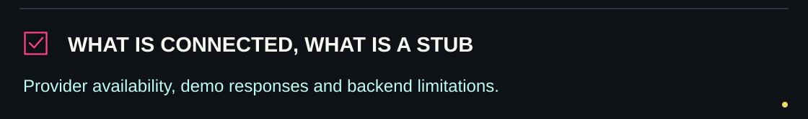</picture></p>

## Integration status

| Area | What the current source establishes |
|---|---|
| React frontend | React 18, TypeScript, Vite 5, Tailwind CSS, React Router and Framer Motion |
| Supabase | Auth/session configuration and database subscription/write paths; project setup and rules are required |
| BLE | GATT parsing and notification code; needs matching firmware and supported browser/device |
| Gemini | Helpers still request `gemini-1.5-pro`; this model has been retired, so those live requests need a separate integration update |
| Python backend | `ml_backend/api/main.py` exposes fixed mock bark/skin/motion responses and a simulated combined score |
| TensorFlow/model helpers | Present in the frontend; inspect actual weights, fallback branches and evaluation evidence for the path being used |
| Hardware | KiCad and Gerber files are included; file presence is not a deployed-board validation result |

Google records the Gemini 1.5 Pro shutdown in its [official model shutdown notes](https://firebase.google.com/docs/ai-logic/faq-and-troubleshooting). A key alone will not restore a retired model. The backend's `/health` response also does not demonstrate that nine trained models are loaded: inspect the implementation rather than treating its fixed response as verification.

No provider key, live model migration, physical-device test or paid API request was performed for this README draft. Application code and model artifacts are unchanged.


<p><picture><source media="(max-width: 600px)" srcset="assets/readme/section-source-mobile.svg"/>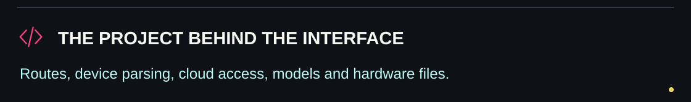</picture></p>

## Explore the source

<p align="center"><a href="src/App.tsx">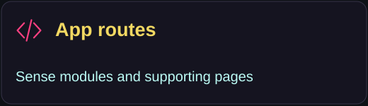</a> <a href="src/hooks/useBleCollar.ts">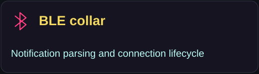</a> <a href="src/hooks/useLiveSensorData.ts">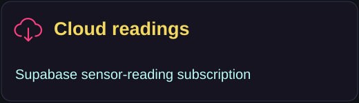</a> <a href="src/pages/PetChatbot.tsx">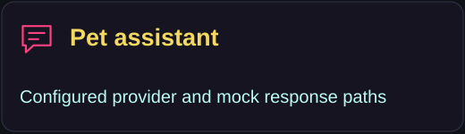</a> <a href="src/lib/generateVetPdf.ts">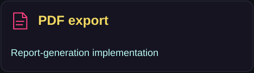</a> <a href="hardware/">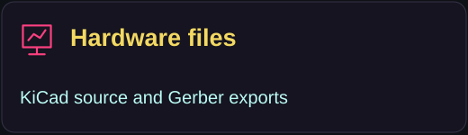</a></p>

| Area | Source |
|---|---|
| Frontend shell and navigation | [AppLayout.tsx](src/components/AppLayout.tsx) · [Dashboard.tsx](src/pages/Dashboard.tsx) |
| Nine Sense interfaces | [src/pages/](src/pages/) |
| AI and fallback helpers | [gemini.ts](src/lib/gemini.ts) · [aiServices.ts](src/lib/aiServices.ts) |
| Bark processing | [audioFeatureExtractor.ts](src/lib/audioFeatureExtractor.ts) · [mlBarkClassifier.ts](src/lib/mlBarkClassifier.ts) |
| Skin processing | [mlSkinClassifier.ts](src/lib/mlSkinClassifier.ts) · [tfSkinClassifier.ts](src/lib/tfSkinClassifier.ts) |
| Database setup | [supabase/](supabase/) |
| Mock backend routes | [main.py](ml_backend/api/main.py) |
| Mobile wrapper | [capacitor.config.json](capacitor.config.json) |

**Developed by Pawsitive Innovators.** Project maintained by Adil Sukumar. The original project direction—bridging animals and technology—remains, with capabilities described at the level supported by the current source.


<p><picture><source media="(max-width: 600px)" srcset="assets/readme/closing-mobile.svg"/>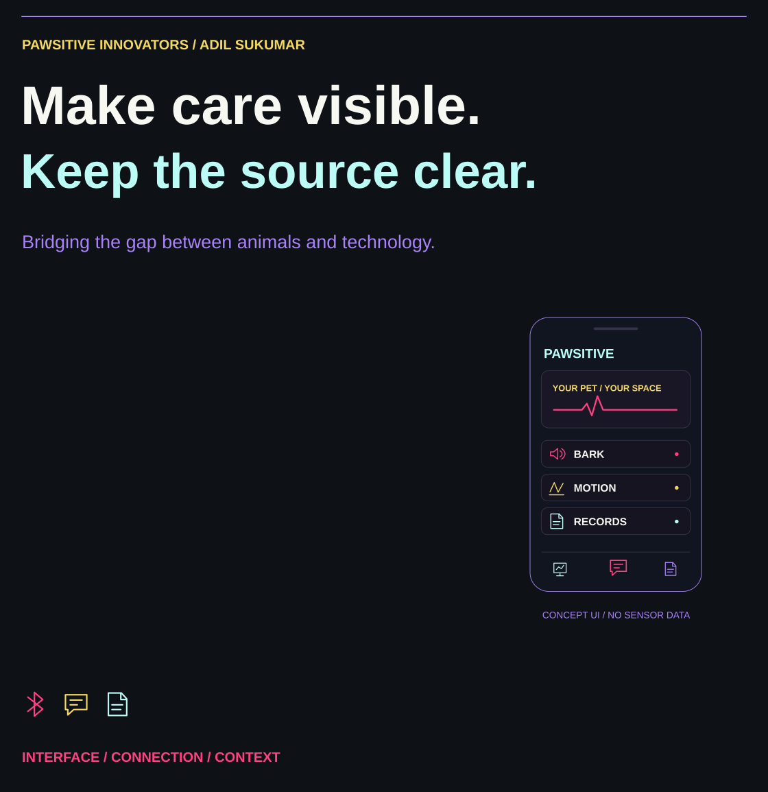</picture></p>
